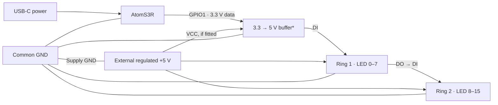

# ESPHome Kids Lamp

[English](README.md) · [Українська](README.uk.md)

A compact two-zone RGB night light: **M5Stack AtomS3R + two 8-LED WS2812B rings** (`WGMCU-2812B-8`). Controlled by the mechanical button beneath the non-touch LCD or Home Assistant. Local controls work without Wi-Fi or HA. No Chain modules required.

**Status:** complete and working in daily use; no further development is planned.

## Mounting

The enclosure is designed to slip over the bed end of an **IKEA GULLIVER** bed. The fit is very tight and takes effort to install; the owner reports that the children cannot remove it. This describes the fit of the existing build, not a certified childproof locking mechanism. [3D model files](models/) can be added for reproduction.

## How it works

Zone 1 covers LEDs **0–7**, zone 2 covers **8–15**. Each has independent color, brightness and power. HA exposes two RGB lights plus both-on/both-off buttons.

| Screen | Short press | Double press | Hold ≥700 ms |
| --- | --- | --- | --- |
| Zone selection | Other zone | Both off if either is on; otherwise both on | Zone menu |
| Menu | Color → brightness → power | Zone selection | Open setting or toggle power |
| Color / brightness | Next value | Zone selection | Menu |

- **Brightness:** 30 → 50 → 75 → 100 → 30%. **Color:** warm white → yellow → green → light blue → purple. HA supports arbitrary RGB and brightness.
- Entering color/brightness switches the selected zone on with its current values. Changes apply immediately; default transition is **1 second**. After a custom HA value, the button selects the next higher brightness preset or warm white for an off-palette color.
- After **30 seconds** without button activity, a moon screen appears. The first gesture only wakes the display. HA does not change navigation or wake it. Short actions wait for the **350 ms** double-click window.
- On reboot, both lights are **off** while color/brightness are retained. First-use defaults are 30% and warm white; flash writes are delayed up to **5 seconds**.

## Wiring

Data is daisy-chained; ring power is parallel. The functional diagram below shows a suggested buffered connection; it does not confirm the exact power wiring or presence of a buffer in the installed lamp.



**Grove HY2.0-4P:** white — GPIO1 (data), black — GND; yellow GPIO2 is unused. With separate USB controller power as shown, **isolate** the red Grove +5 V wire. Leave ring 2 DO unconnected. Verify orientation against the [official M5Stack pin map](https://docs.m5stack.com/en/core/AtomS3R).

**Power:** never power LEDs from a GPIO or join positive outputs of independent supplies. Common GND is required. Direct 3.3 V data is not guaranteed for an unknown WS2812B revision; *a [74AHCT125](https://www.ti.com/product/SN74AHCT125) buffer is recommended, with OE, power and decoupling correctly wired per its datasheet.

There is no firmware current limiter; the menu allows 100%. A conservative ring-only budget is **0.96 A**, assuming 60 mA/LED, rather than a measured board specification. Start at low brightness through HA and check current and temperature. Keep mains outside the enclosure.

## Installation

Requires ESPHome **2026.10.0+** with ESP-IDF. In Home Assistant ESPHome Device Builder, retain your existing `esphome`, `esp32`, `logger`, `api`, `ota`, `wifi` and `captive_portal` configuration and append:

```yaml
packages:
  kids_night_lamp:
    url: https://github.com/alexeyzel/esphome-kids-lamp
    ref: main
    files: [packages/lamp.yaml]
    refresh: 0s
```

See [minimal package example](examples/home-assistant.yaml). The package contains no credential references; your local base supplies them. For a complete starting configuration use [kids-night-lamp.yaml](kids-night-lamp.yaml), copy `secrets.yaml.example` to a local `secrets.yaml`, and replace every placeholder. Never commit that file.

Validate, then install using Device Builder. ESPHome fetches helper headers through `external_components`; no manual header copying is needed. Internet is needed to fetch build dependencies, while local controls work without Wi-Fi or HA after flashing.

`refresh: 0s` checks sources during validation/build; it does not update firmware automatically. For a reproducible build, pin both the package `ref` and local `substitutions.project_ref` to the same commit SHA.

The default display is ST7735. For an older GC9107 revision add:

```yaml
substitutions:
  lcd_model: GC9107
  lcd_pad_y: '1'
```

Confirm the display revision on your device. The current idle backlight PWM is 128/255 and active PWM is 80/255; idle PWM is therefore higher even though the moon drawing is dim. These are the current firmware settings.

## Files and validation

[Upload 3D models here](models/) · [Bench checks](docs/testing-menu.md) · [Privacy](SECURITY.md)

`packages/lamp.yaml` — firmware; `components/kids_lamp/` — menu and graphics; `examples/` — HA integration; `tests/` — C++ tests; `docs/` — detailed technical records.

```sh
esphome config kids-night-lamp.yaml
esphome compile kids-night-lamp.yaml
c++ -std=c++17 -Wall -Wextra -Werror tests/lamp_controls_test.cpp -o lamp_controls_test
./lamp_controls_test
```

Keep secrets local. Personal lamp names were removed from current files, but Git history still contains author information and former names; see the [privacy review](SECURITY.md).

## AI assistance

Firmware and documentation were developed with AI assistance. This is a completed DIY build; no product certification or IKEA affiliation is claimed.
