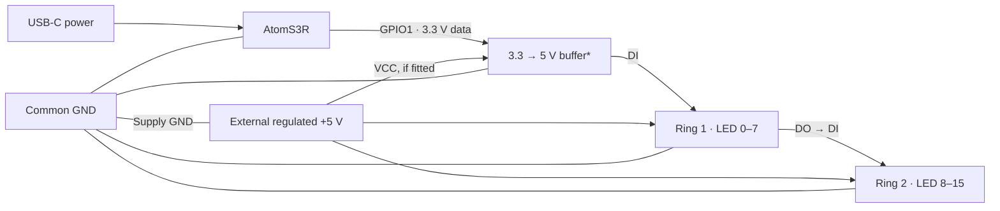

# ESPHome Kids Lamp

[English](README.md) · [Українська](README.uk.md)

Компактний нічник із двома незалежними RGB-зонами: **M5Stack AtomS3R + два кільця WS2812B по 8 LED** (`WGMCU-2812B-8`). Керування механічною кнопкою під несенсорним LCD або через Home Assistant. Працює локально без Wi-Fi та HA. Chain-модулі не потрібні.

**Стан:** завершений нічник, який працює у щоденному використанні. Подальший розвиток не планується.

## Кріплення

Корпус розрахований на надягання на спинку ліжка **IKEA GULLIVER**. Посадка дуже щільна: встановлення потребує зусилля, зате, за досвідом власника, діти не можуть зняти нічник. Це опис фактичної посадки, а не сертифікований захист від зняття дітьми. [Файли 3D-моделей](models/) можна додати для відтворення конструкції.

## Як працює

Зона 1 — LED **0–7**, зона 2 — **8–15**. Кожна має власні колір, яскравість і стан. У HA доступні два RGB-світильники та кнопки ввімкнення/вимкнення обох.

| Екран | Коротке | Подвійне | Утримання ≥700 мс |
| --- | --- | --- | --- |
| Вибір зони | Інша зона | Вимкнути обидві, якщо хоча б одна ввімкнена; інакше ввімкнути обидві | Меню зони |
| Меню | Колір → яскравість → живлення | До вибору зони | Відкрити налаштування або перемкнути живлення |
| Колір / яскравість | Наступне значення | До вибору зони | До меню |

- **Яскравість:** 30 → 50 → 75 → 100 → 30%. **Колір:** теплий білий → жовтий → зелений → блакитний → фіолетовий. Через HA — довільний RGB та яскравість.
- Вхід у колір/яскравість вмикає вибрану зону з поточними значеннями. Зміни застосовуються одразу; типовий плавний перехід — **1 с**. Після довільного значення HA кнопка обирає наступний вищий рівень яскравості або теплий білий для кольору поза палітрою.
- Через **30 с** без кнопки — заставка з місяцем. Перший жест лише будить екран. HA не змінює навігацію й не будить його. Коротка дія очікує вікно подвійного натискання **350 мс**.
- Після перезапуску світло **вимкнене**, колір і яскравість зберігаються. Перші значення — 30% і теплий білий; запис flash відкладено до **5 с**.

## Підключення

Сигнал послідовний, живлення кілець паралельне. Нижче наведено функціональну схему рекомендованого підключення з буфером; вона не підтверджує точну комутацію живлення чи наявність буфера у встановленому нічнику.



**Grove HY2.0-4P:** білий — GPIO1 (дані), чорний — GND; жовтий GPIO2 не використовується. У показаному варіанті з окремим USB-живленням контролера червоний +5 В Grove **ізолювати**. DO другого кільця залишити вільним. Орієнтацію звіряти з [офіційною розпіновкою M5Stack](https://docs.m5stack.com/en/core/AtomS3R).

**Живлення:** не живіть LED від GPIO й не з'єднуйте плюсові виходи незалежних джерел. Спільна GND обов'язкова. Прямий сигнал 3,3 В для невідомої ревізії WS2812B не гарантований; *рекомендований буфер — [74AHCT125](https://www.ti.com/product/SN74AHCT125), з правильно підключеними OE, живленням і розв'язуванням за datasheet.

Програмного ліміту струму немає, меню дозволяє 100%. Орієнтир для планування кілець — до **0,96 А** за припущення 60 мА/LED, а не виміряна характеристика. Починайте з малої яскравості через HA, перевірте струм і нагрівання. Мережева напруга — лише поза корпусом.

## Установлення

Потрібен ESPHome **2026.10.0+**, ESP-IDF. У Device Builder збережіть власні розділи `esphome`, `esp32`, `logger`, `api`, `ota`, `wifi`, `captive_portal` та додайте:

```yaml
packages:
  kids_night_lamp:
    url: https://github.com/alexeyzel/esphome-kids-lamp
    ref: main
    files: [packages/lamp.yaml]
    refresh: 0s
```

[Мінімальний приклад](examples/home-assistant.yaml) підключає пакет без облікових даних. [Повний приклад](kids-night-lamp.yaml) використовує `!secret`: скопіюйте `secrets.yaml.example` у локальний `secrets.yaml` та замініть усі шаблонні значення. Не додавайте секрети в Git.

Виконайте Validate, потім Install. Заголовки завантажуються автоматично через `external_components`. Інтернет потрібен для завантаження залежностей збірки; прошитий нічник керується локально без HA та Wi-Fi.

`refresh: 0s` перевіряє джерела під час перевірки/збірки, але не оновлює пристрій автоматично. Для фіксованої версії задайте однаковий commit SHA у `ref` пакета та локальному `substitutions.project_ref`.

Типовий дисплей — ST7735. Для старої ревізії GC9107:

```yaml
substitutions:
  lcd_model: GC9107
  lcd_pad_y: '1'
```

Перевірте ревізію свого пристрою. Поточний PWM очікування — 128/255, активний — 80/255: підсвічування очікування має вищий PWM, хоча сам місяць намальований тьмяно. Це поточні налаштування прошивки.

## Файли та перевірка

[3D-моделі — завантажувати сюди](models/) · [Перевірки на стенді](docs/testing-menu.md) · [Приватність](SECURITY.md)

`packages/lamp.yaml` — прошивка; `components/kids_lamp/` — меню й графіка; `examples/` — підключення HA; `tests/` — C++ тести; `docs/` — детальні технічні записи.

```sh
esphome config kids-night-lamp.yaml
esphome compile kids-night-lamp.yaml
c++ -std=c++17 -Wall -Wextra -Werror tests/lamp_controls_test.cpp -o lamp_controls_test
./lamp_controls_test
```

Секрети зберігайте локально. Персональні назви прибрано з поточних файлів, але історія Git ще містить персональні дані автора та старі назви; див. [результати перевірки](SECURITY.md).

## Використання ШІ

Прошивку й документацію розроблено за допомогою ШІ. Це завершений DIY-проєкт; сертифікація виробу та зв’язок з IKEA не заявляються.
